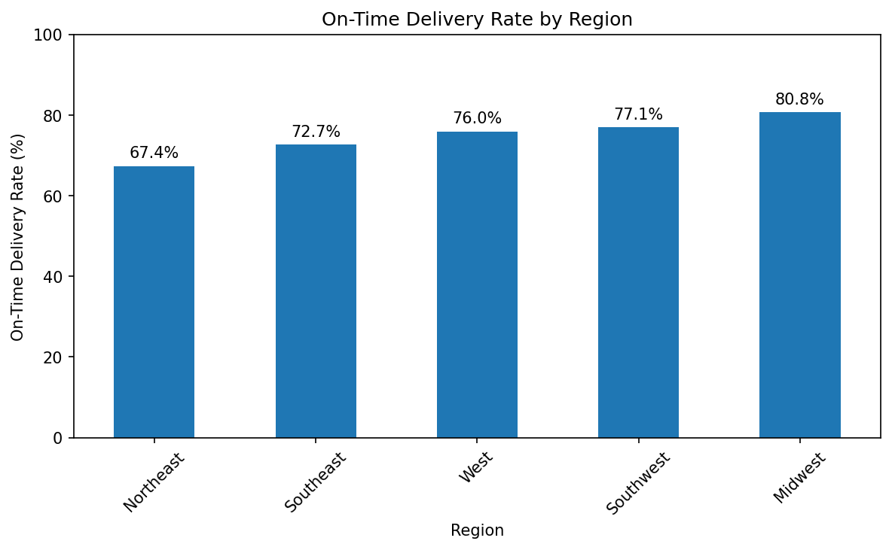

# Logistics Shipment Performance Analysis

## Project Overview

This project analyzes a synthetic dataset of 240 shipments to evaluate shipping costs, carrier performance, and on-time delivery rates.

I used Python, pandas, and Matplotlib to calculate key performance indicators (KPIs), compare shipping methods, and identify regional delivery trends.

**Note:** All data is fictional and created for portfolio practice.

## Business Questions

- What is the total shipping cost and average cost per shipment?
- What percentage of shipments arrived on time?
- How do average shipping costs differ by carrier?
- Which regions have the strongest and weakest on-time delivery performance?
- How do costs compare between Less-than-Truckload (LTL) and Full Truckload (FTL) shipments?

## Key Results

| KPI | Result |
|---|---:|
| Total shipments analyzed | 240 |
| Total shipping cost | $387,161.52 |
| Average cost per shipment | $1,613.17 |
| Overall on-time delivery rate | 75.0% |

## Key Insights

- **Regional performance:** The Midwest had the highest on-time delivery rate at approximately 81%, while the Northeast had the lowest at approximately 67%.
- **Shipping mode:** Average FTL shipping cost was approximately $1,940 per shipment, compared with approximately $1,410 for LTL shipments.
- **Carrier performance:** Comparing average costs and delivery rates can help identify areas for further investigation.
- **Business recommendation:** Investigate delivery delays in the Northeast and compare shipment distance, shipment size, and service requirements before making operational changes.
- 

These findings describe the synthetic dataset only and should not be treated as actual company performance.

## Tools Used

- Python
- pandas
- Matplotlib
- Google Colab
- GitHub

## Project Files

- [Jupyter Notebook](Logistics_shipment_analysis.ipynb) - Analysis and visualizations.
- [Python Script](analysis.py) - KPI calculations and charts.
- [Dataset](shipments.csv) - Synthetic shipment records.

## How to Run

1. Open the notebook in Google Colab.
2. Upload shipments.csv to the Colab session.
3. Run the code cells from top to bottom.
4. Review the KPI results, carrier summary, and charts.

## Skills Demonstrated

- Data cleaning and inspection
- KPI calculation
- Data aggregation
- Carrier performance analysis
- Regional comparisons
- Data visualization
- Communicating business insights
